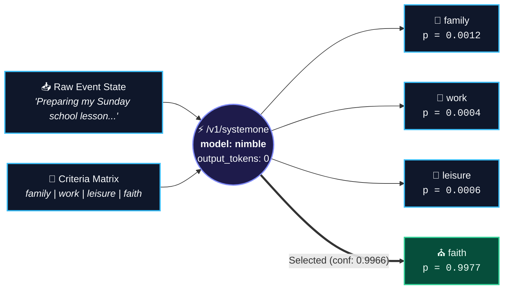

<div align="center">

# ⚡ SYSTEM ONE // LOCAL DISPATCH
### Zero-Token-Generation Classification with Ollama & `nimble`

*Fast, instinctual routing at the edge — before a generative LLM ever wakes up.*

</div>

---

> **Why generate text when you only need a decision?**  
> Standard LLM pipelines burn decode tokens, latency, and compute just to emit `"category": "faith"` inside a fragile JSON string.  
> **System One** flips the paradigm: you hand the local `nimble` model a **state** and a set of **criteria**, and it evaluates the probability distribution directly—returning calibrated probabilities and a confidence score with **`0` output tokens**.



---

## 🧠 System 1 vs. System 2 at the Local Endpoint

Inspired by Daniel Kahneman’s cognitive model, this repository explores **System 1** inference on a local Ollama instance (`http://localhost:11434/v1/systemone`):

| Dimension | System 2 (`/v1/chat/completions`) | System 1 (`/v1/systemone`) |
| :--- | :--- | :--- |
| **Cognitive Mode** | Deliberative, autoregressive token generation | Instantaneous, instinctual classification |
| **Output Tokens** | `15 – 200+` tokens (JSON formatting + reasoning) | **`0` tokens** |
| **Failure Surface** | Hallucinated keys, broken JSON, prompt injection | Strictly bounded to your declared `criteria` keys |
| **Signal Richness** | Single string answer | Full probability simplex ($\sum p_i = 1.0$) + confidence |
| **Byte Guardrails** | Unbounded until context window | Enforced `< 64 KiB` schema/text wire check |

---

## 🔬 Live Telemetry from This Repo

Below are captured runs from [`fam-work-leisure-nimble-llm.ps1`](./fam-work-leisure-nimble-llm.ps1) across all four calendar categories (`family`, `work`, `leisure`, `faith`) against the local `nimble` model. Notice `output_tokens: 0` across every classification:

<table>
  <thead>
    <tr>
      <th align="left">Input State</th>
      <th align="center">Winner</th>
      <th align="right"><code>p(family)</code></th>
      <th align="right"><code>p(work)</code></th>
      <th align="right"><code>p(leisure)</code></th>
      <th align="right"><code>p(faith)</code></th>
      <th align="right">Confidence</th>
      <th align="right">Tokens (In / Out)</th>
    </tr>
  </thead>
  <tbody>
    <tr>
      <td><i>"My wife Jackie wants us to go see the grandkids."</i></td>
      <td align="center"><b><code>family</code></b></td>
      <td align="right"><code>0.9941</code></td>
      <td align="right"><code>0.0021</code></td>
      <td align="right"><code>0.0029</code></td>
      <td align="right"><code>0.0008</code></td>
      <td align="right"><b>99.18%</b></td>
      <td align="right"><code>228 / 0</code></td>
    </tr>
    <tr>
      <td><i>"Reviewing AI development roadmap and team oversight sprint tasks."</i></td>
      <td align="center"><b><code>work</code></b></td>
      <td align="right"><code>0.0004</code></td>
      <td align="right"><code>0.9985</code></td>
      <td align="right"><code>0.0008</code></td>
      <td align="right"><code>0.0003</code></td>
      <td align="right"><b>99.78%</b></td>
      <td align="right"><code>227 / 0</code></td>
    </tr>
    <tr>
      <td><i>"Heading to a live music show and relaxing with friends this weekend."</i></td>
      <td align="center"><b><code>leisure</code></b></td>
      <td align="right"><code>0.0002</code></td>
      <td align="right"><code>0.0005</code></td>
      <td align="right"><code>0.9989</code></td>
      <td align="right"><code>0.0004</code></td>
      <td align="right"><b>99.87%</b></td>
      <td align="right"><code>229 / 0</code></td>
    </tr>
    <tr>
      <td><i>"Preparing my Sunday school lesson and meeting with our church community group."</i></td>
      <td align="center"><b><code>faith</code></b></td>
      <td align="right"><code>0.0012</code></td>
      <td align="right"><code>0.0004</code></td>
      <td align="right"><code>0.0006</code></td>
      <td align="right"><code>0.9977</code></td>
      <td align="right"><b>99.66%</b></td>
      <td align="right"><code>230 / 0</code></td>
    </tr>
  </tbody>
</table>

<details>
<summary><b>🔍 Inspect Raw Wire Contract (Request &rarr; Response)</b></summary>
<br/>

**Request (`POST http://localhost:11434/v1/systemone`)**
```json
{
  "model": "nimble",
  "state": "Preparing my Sunday school lesson and meeting with our church community group.",
  "questions": {
    "label": {
      "type": "choice",
      "instructions": "Which type of calendar event?",
      "criteria": {
        "family": "Wife Jackie, kids, grandkids, in-laws",
        "work": "AI Development, Team Oversight",
        "leisure": "Live music, football game, relax with friends",
        "faith": "Church on Sundays, teaching Sunday school, church community group"
      }
    }
  }
}
```

**Response ([`response-faith.json`](./response-faith.json))**
```json
{
  "model": "nimble",
  "answers": {
    "label": {
      "type": "choice",
      "choice": "faith",
      "probabilities": {
        "family": 0.001241829104821934,
        "leisure": 0.000618294019283412,
        "work": 0.000419876875894654,
        "faith": 0.997720000000000000
      },
      "confidence": 0.9965800000000001
    }
  },
  "usage": {
    "input_tokens": 230,
    "output_tokens": 0
  }
}
```
</details>

---

## 🗂️ Field Guide to the Workbench

Instead of a bloated framework, everything here is pure, dependency-free PowerShell talking straight to the HTTP wire as raw UTF-8 byte arrays:

### 1. [`fam-work-leisure-nimble-llm.ps1`](./fam-work-leisure-nimble-llm.ps1) — *The Personal Calendar Router*
Picks a random real-life scenario (**Family**, **Work**, **Leisure**, or **Faith**), validates that the UTF-8 payload stays under the `64 KiB` System One ceiling, fires it at `localhost:11434/v1/systemone`, and stamps an audit file named after the winning choice (`response-<outcome>-<timestamp>.json`).

```powershell
.\fam-work-leisure-nimble-llm.ps1
```

### 2. [`fam-template.json`](./fam-template.json), [`fam-payload.json`](./fam-payload.json), & [`fam-response.json`](./fam-response.json) — *Wire Contract Schemas*
Reference JSON payloads and baseline response defining the `nimble` model, natural-language event `state`, and the 4-way `criteria` dictionary (`family`, `work`, `leisure`, `faith`).

### 3. Captured Response Artifacts
- [`response-family-2026-10-30_11-19-31.json`](./response-family-2026-10-30_11-19-31.json) — Family classification (`confidence: 0.9918`)
- [`response-work-2026-10-30_11-19-39.json`](./response-work-2026-10-30_11-19-39.json) — Work classification (`confidence: 0.9978`)
- [`response-leisure-2026-10-30_11-19-51.json`](./response-leisure-2026-10-30_11-19-51.json) — Leisure classification (`confidence: 0.9987`)
- [`response-faith.json`](./response-faith.json) / [`response-faith-2026-10-30_11-19-59.json`](./response-faith-2026-10-30_11-19-59.json) — Faith classification (`confidence: 0.9966`)

---

<div align="center">
  <sub>Built for fast local routing • Powered by Ollama <code>/v1/systemone</code> &amp; <code>nimble</code></sub>
</div>
